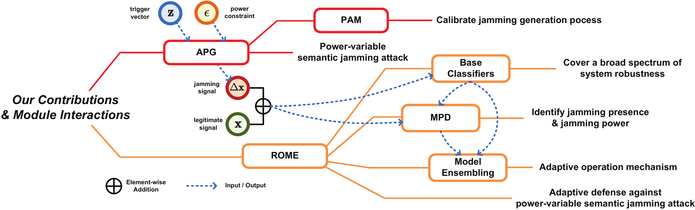

# ROME

PyTorch implementation of the receiver in [ROME: Robust Model Ensembling for Semantic Communication Against Semantic Jamming Attacks (IEEE TWC 2026)](https://doi.org/10.1109/TWC.2025.3597672), extending the [PIMRC 2024 paper](https://doi.org/10.1109/PIMRC59610.2024.10817194). ROME detects interference and combines the predictions of four classifiers.



## Usage

Evaluate the pretrained receiver on CIFAR-10 using Python 3.12. The first run downloads the dataset.

```bash
python -m pip install -r requirements.txt
python test.py
```

The weights in `checkpoints/` are for a 13 dB AWGN channel and bandwidth ratio 1/4.

To fine-tune and evaluate on your own recordings, supply NPZ files containing `received` (N × 24 × 8 × 8), `labels` (0–9), and `levels` (0–3).

```bash
python train_receiver.py train.npz --output runs/receiver
python test.py --weights runs/receiver --recordings test.npz
```

## APG results

The [results folder](results/) contains archived accuracy curves from Figs. 9 and 16. To plot them, run

```bash
python -m pip install matplotlib
python results/plot.py
```

## Citation

```bibtex
@article{zhou2026rome,
  author  = {Zhou, Kequan and Zhang, Guangyi and Cai, Yunlong and Hu, Qiyu and Yu, Guanding},
  title   = {{ROME}: Robust Model Ensembling for Semantic Communication Against Semantic Jamming Attacks},
  journal = {IEEE Trans. Wireless Commun.},
  year    = {2026},
  volume  = {25},
  pages   = {2589--2606}
}

@inproceedings{zhou2024robust,
  author    = {Zhou, Kequan and Zhang, Guangyi and Cai, Yunlong and Hu, Qiyu and Yu, Guanding},
  title     = {Robust Model Ensembling Against Wireless Adversarial Attacks for Semantic Communications},
  booktitle = {Proc. IEEE Int. Symp. Pers., Indoor Mobile Radio Commun. (PIMRC)},
  year      = {2024},
  pages     = {1--6},
  month     = {Sept.},
  address   = {Valencia, Spain}
}
```

## License

The code and pretrained weights are released under the [MIT License](LICENSE).
